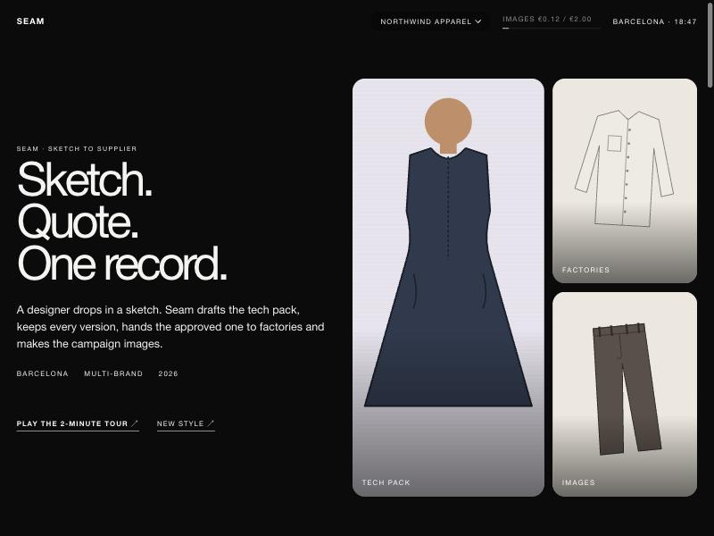

# Seam

Sketch to supplier quote, on one record.

A designer drops in a garment sketch. Seam drafts the tech pack, keeps every version, sends the approved one to factories, collects their quotes and makes campaign images. Every step writes to the same record, so nothing gets lost between tools and nothing happens twice.

**Live demo:** _link coming_ · press **Play the 2-minute tour** and watch one garment go from sketch to three factory quotes.



## Why I built it

Fashion teams pass a garment through many hands and many tools: moodboard, sketch, tech pack, PLM, supplier portal, image studio. Each handoff is a chance to lose a change or send the wrong version to a factory. I wanted to build the backend piece that holds all of it together: **one record per garment that every tool reads and writes.**

The AI part is small on purpose. A vision model reads the sketch and says what garment it is and which details it can see. Everything a factory relies on (sizes, grading, fabric use, cost) comes from plain code, so the same input always gives the same numbers.

## What it does

1. **Sketch to tech pack.** Upload a sketch. A background job reads it and drafts a tech pack with 7 points of measure graded across 5 sizes, a bill of materials, construction notes and a target price.
2. **Versions, never overwrites.** Every edit is a new draft. Only one version is approved at a time. A diff shows what changed and whether it changes the price.
3. **Factory handoff.** The approved version goes to three test factories at once. One answers straight away, one is down for the first two tries, and one saves the order but loses its first reply.
4. **Stale quotes.** If a later version changes what the factory makes (fabric, details, measurements), older quotes are marked out of date, with the reason. A note on its own does not.
5. **Campaign images.** Flat lay, on model and detail shots, paid from a monthly budget per brand. A garment that looks the same as one already shot reuses the picture for free. Each image records which model made it, with which seed, from which version.
6. **Timeline.** Every step lands in one event log, so the page can show sketch to first quote in seconds.

## How it works

```
 browser ──► FastAPI ──► Postgres ◄── worker threads ──► factory systems
                │           │                │
                │      row level security    └── jobs table (lease + SKIP LOCKED)
                └── one transaction writes the data AND the job that needs it
```

### Brands are walled off in the database

Every brand table has row level security, forced on, so it applies to the table owner too. Each request opens a transaction and sets `app.brand_id` for that transaction only. A query with no `WHERE` clause at all still only sees one brand. Writing a row for another brand fails.

Superusers skip row level security even when it is forced. I found that the hard way on day one, when my local superuser could see both brands. So the app now checks its own database role on start and refuses to run if that role can skip the wall.

### The job queue lives in Postgres

I didn't add Redis or a broker. A job is written in the same transaction as the data it works on, so there is no gap where the style exists but its job doesn't, or the other way round.

- Workers claim jobs with `FOR UPDATE SKIP LOCKED`, so eight workers never grab the same job and never wait on each other.
- A claim is a 30-second lease. If a worker dies, the lease runs out and another worker takes the job.
- Only the worker holding the lease can close the job. A worker that comes back after losing its lease can't overwrite the new result.
- Failures back off (1s, 2s, 4s…). After the last try the job is marked dead and kept for a person to look at.
- Every handler is safe to run twice.

### Factories never get an order twice

Each handoff has an idempotency key made from the version and the factory, and it is sent on every try. When the Dhaka test factory saves an order and loses the reply, the retry gets the same quote back. The factory holds one order after two deliveries, and the demo shows both numbers side by side.

A draft can't reach a factory: a trigger in the database rejects it, not just the API.

### Images are paid for once

An image request is keyed by what the garment looks like (garment, fabric, details, shot, model), not by its version number. A note or a measurement tweak keeps the same look, so the picture is reused. The budget is spent with one `UPDATE … WHERE spent + cost <= limit`, so two requests racing for the last few cents can't both win. If an image job dies, the money is refunded.

The demo renders simple SVG previews instead of calling a paid image model, so the queue, budget, reuse and provenance all work for real without GPU costs. Swapping in a real model means replacing one function.

## Numbers

- **30 tests**, run against real Postgres with a normal (non-superuser) role, the same way production runs. They cover the brand wall, crash recovery, lost leases, retries without double orders, budget races under threads, stale quotes and the tech pack rules.
- **Load test** (`scripts/loadtest.py`, 150 styles, 32 at a time, one process with 4 worker threads, on my laptop):

| Step | p50 | p95 | Throughput |
|---|---|---|---|
| Upload a sketch | 57 ms | 86 ms | 494 req/s |
| Approve a version | 53 ms | 109 ms | 501 req/s |
| Send to 3 factories | 63 ms | 83 ms | 480 req/s |
| Read a full style | 66 ms | 91 ms | 462 req/s |
| List styles | 73 ms | 96 ms | |

  - All 150 tech packs were drafted **0.6 s** after the last upload.
  - All 450 factory orders were quoted in 65 s, with 900 deliveries in total because of the flaky factories. Each factory still holds exactly **one order per request** (Dhaka: 50 orders from 100 deliveries).
  - Zero dropped connections.
  - The first run showed the style list at 330 ms once a brand had about 500 styles. I capped the list and added an index on `(brand_id, created_at)`, which brought it to 73 ms.
  - The handoff is bound by factory response time, not by Seam. Four worker threads each wait on a slow factory. More threads or more worker processes make it go faster, and they can run on separate machines because the queue is just Postgres.

## Run it

```bash
docker compose up -d                 # Postgres with a normal app role
python -m venv .venv && . .venv/bin/activate
pip install -r requirements-dev.txt
uvicorn seam.api:app --reload        # http://localhost:8000
pytest -q                            # 30 tests
scripts/smoke.sh http://localhost:8000
python scripts/loadtest.py http://localhost:8000 --styles 150
```

Set `ANTHROPIC_API_KEY` to have a vision model read PNG and JPEG sketches. Without it, Seam uses the designer's own choices from the upload form.

The API docs are at `/docs`. Every call takes an `X-API-Key` header. The demo keys are `demo-northwind` and `demo-kestrel`.

```bash
curl -H "X-API-Key: demo-northwind" -F code=SS27-TEE-01 -F name="Boxy tee" \
     -F garment=tee -F features=chest_pocket -F sketch=@static/samples/tee.svg \
     http://localhost:8000/api/styles
```

## Project layout

```
seam/api.py         HTTP routes
seam/service.py     what each route does, one brand transaction each
seam/techpack.py    sizes, grading, materials, cost, diff (plain rules)
seam/sketch.py      reads a sketch with a vision model, if a key is set
seam/jobs.py        the Postgres job queue and workers
seam/handlers.py    background jobs: draft, factory handoff, images
seam/sim.py         three test factory systems
seam/render.py      preview image renderer
migrations/         SQL, applied in order on start
tests/              30 tests
scripts/            smoke test, load test
```

## What I would do next

- Connect a real PLM and real supplier portals behind the same handoff code.
- Move sketches and images to object storage and keep only keys in Postgres.
- Wake workers with `LISTEN/NOTIFY` instead of short polling.
- Split events by month once the log gets large.
- Add per-user roles inside a brand (designer, product developer, buyer) with approval rights.
